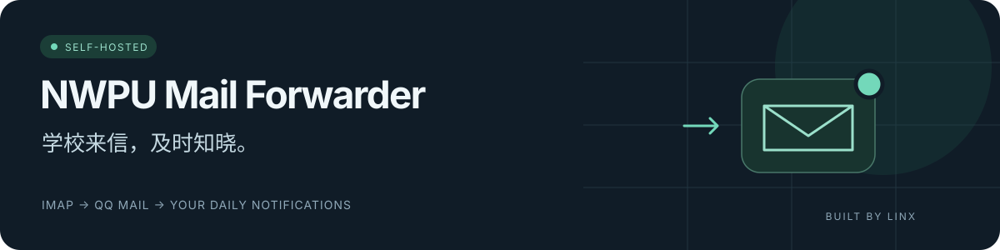
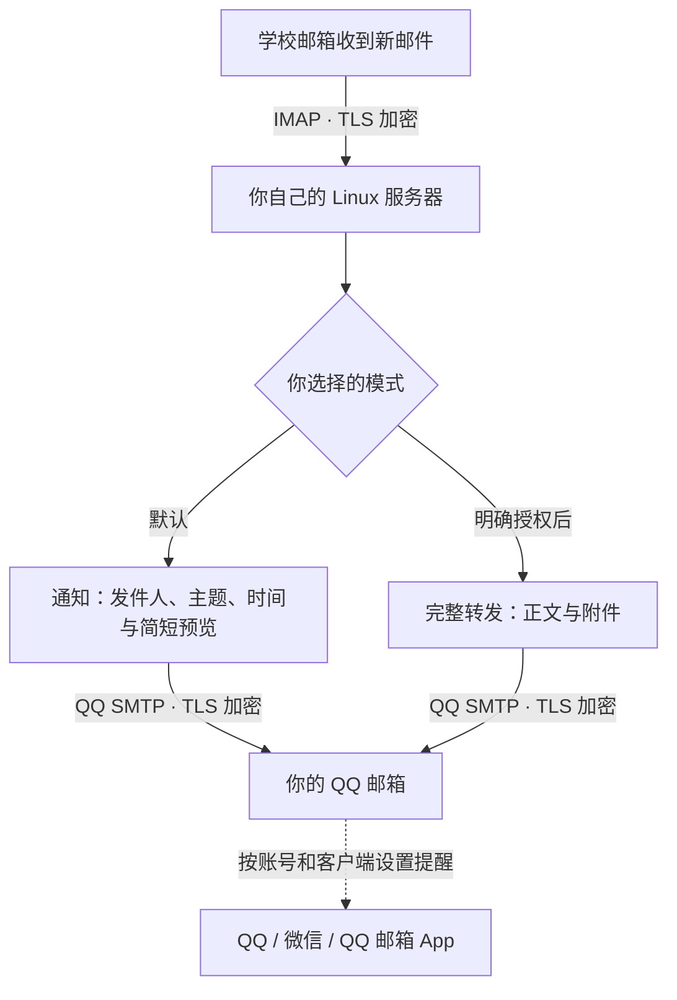
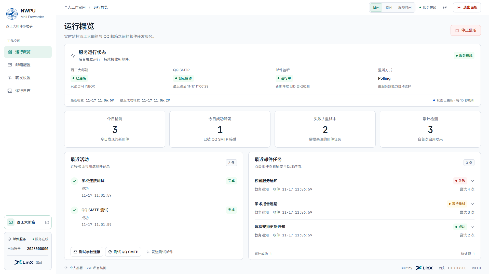
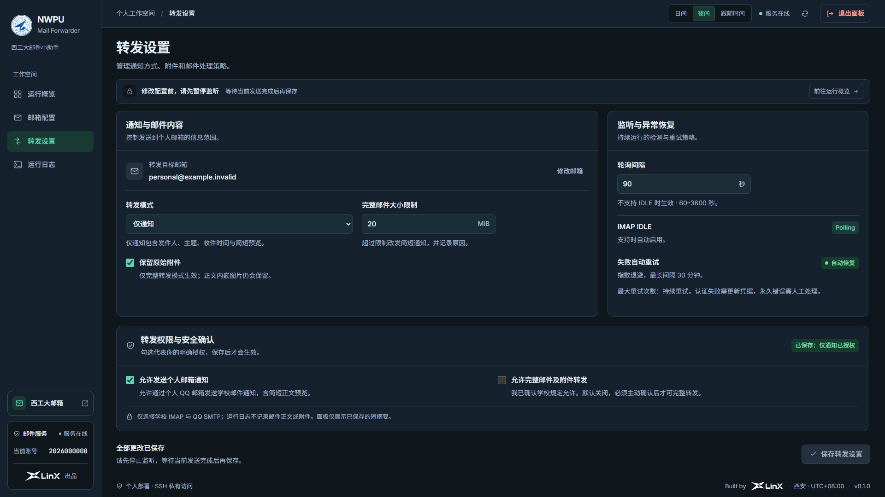
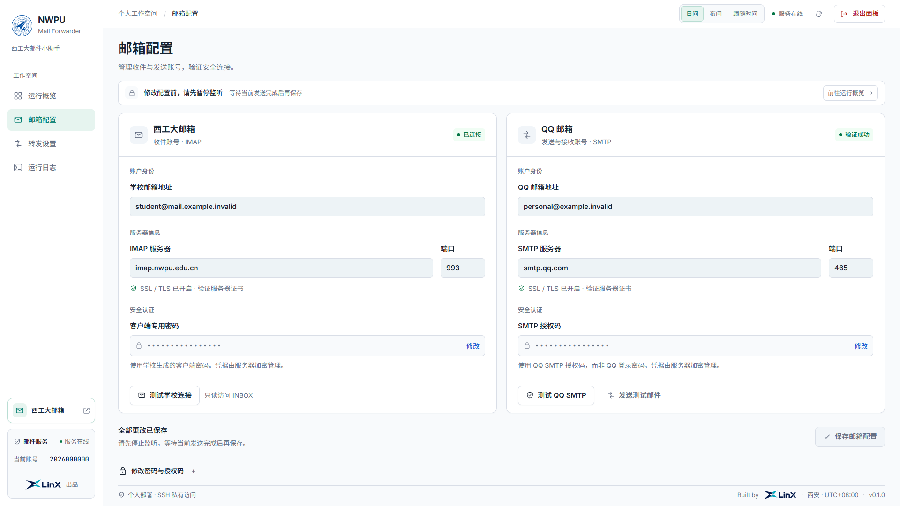
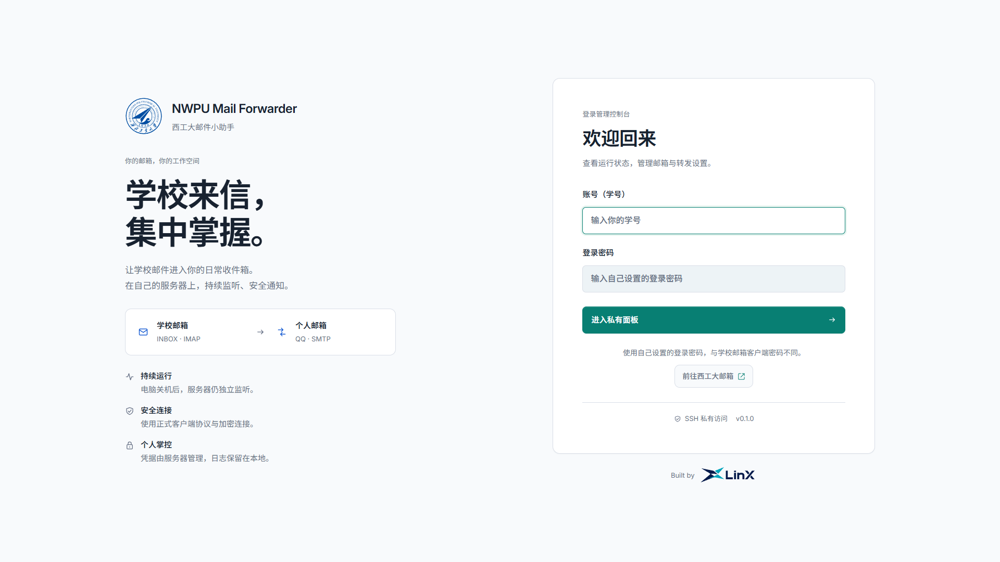

<div align="center">



# NWPU Mail Forwarder

**少登录一次学校邮箱，少错过一封重要来信。**

西工大邮件小助手 · 自托管 · QQ 邮箱通知 · 中文管理面板

[](https://github.com/LinX-Wang/nwpu-mail-forwarder/actions/workflows/test.yml)
[](pyproject.toml)
[](LICENSE)
[](https://github.com/LinX-Wang/nwpu-mail-forwarder/releases)

[界面预览](#界面预览) · [快速开始](#快速开始) · [通知设置](#让提醒出现在-qq--微信里) · [部署文档](#文档与维护)

</div>

## 为什么做这个

课程通知、导师来信、学术报告、校园事务……重要信息常常先到学校邮箱。但如果没有顺手的消息提醒，就只能隔一阵登录网页版，看看有没有新邮件。忙起来，很容易忘记。

这个小工具把“反复打开学校邮箱检查”变成“让新邮件进入日常使用的 QQ 邮箱”：在你自己的 Linux 服务器上持续监听学校收件箱，发现新邮件后，通过 QQ 邮箱发送通知；在符合学校规定且你明确授权时，也可以转发完整邮件和附件。

QQ 邮箱收到邮件后，可结合你已有的 **QQ 邮箱提醒、微信「QQ 邮箱提醒」或 QQ 邮箱 App** 接收消息。电脑关机后，服务器仍会继续工作。

> 本项目负责将通知邮件发送至 QQ 邮箱；手机端提醒由 QQ 邮箱及客户端提供。是否提醒、提醒延迟和展示内容，取决于账号绑定、订阅状态、系统通知权限及平台策略，需要用自己的账号实际验证。

## 它是怎么工作的



学校邮箱通过正式客户端协议连接，无需让服务器保持网页登录，也不依赖学校统一身份认证的浏览器会话。

## 界面预览

中文控制台把连接状态、监听情况、发送统计和近期任务集中在一个页面，支持日间、夜间和按时间切换主题，也适配手机。

<picture>
  <source media="(prefers-color-scheme: dark)" srcset="docs/images/overview-dark.png">
  
</picture>

<details>
<summary><strong>展开查看：转发设置、邮箱配置与登录页</strong></summary>

**转发设置** · 选择通知或完整转发，管理附件、大小限制与轮询间隔。



**邮箱配置** · 分别管理学校邮箱与 QQ 邮箱，内置客户端密码和授权码获取教程。



**登录页** · 使用学号与自己设置的面板密码登录，也可直接打开学校邮箱网页版。



</details>

*截图均来自隔离演示环境，账号与邮件为合成数据，不包含真实邮箱凭据或个人邮件。*

## 能帮你做什么

| 能力 | 具体体验 |
| :--- | :--- |
| 持续检查新邮件 | 优先使用 IMAP IDLE；不支持时自动轮询，默认间隔 90 秒 |
| 两种发送模式 | 默认仅通知；完整正文与附件转发需要单独授权 |
| 中文管理面板 | 四页管理：运行概览、邮箱配置、转发设置、运行日志 |
| 断线与失败恢复 | 自动重连、临时错误退避重试，任务持久化保存 |
| 尽量避免重复 | 基于 UID / UIDVALIDITY 与持久化状态追踪已处理邮件 |
| 个人服务器部署 | systemd 常驻，电脑关机后仍运行，不依赖特定云厂商 |
| 手机远程管理 | 默认 SSH 私有访问；可选可信 HTTPS 公网入口 |
| 迁移与回滚 | 导出去重和待发送状态，支持换服务器与版本回退 |

## 快速开始

### 1. 准备好这些

- 一台 **Ubuntu 24.04 / Debian 12** 服务器，具备 sudo 权限；Python 3.11+、systemd 252+。
- 一个可使用 IMAP 的西工大邮箱，以及学校生成的**客户端专用密码**。
- 一个已开启 SMTP 的 QQ 邮箱，以及 **SMTP 授权码**。
- 服务器可访问学校 IMAP SSL 端口和 QQ SMTP SSL 端口，默认分别为 993 / 465。

凭据获取见 [学校邮箱与 QQ 邮箱配置教程](docs/CLIENT_CREDENTIALS.md)。学校客户端密码、QQ 授权码和本工具的面板密码是三种不同的凭据。

### 2. 下载与安装

在服务器下载 [最新发行包](https://github.com/LinX-Wang/nwpu-mail-forwarder/releases)，解压后进入项目目录；也可以使用 Git：

```bash
git clone https://github.com/LinX-Wang/nwpu-mail-forwarder.git
cd nwpu-mail-forwarder
sudo bash deploy/install.sh
sudo nwpu-forwarder credentials
```

凭据向导必须在**交互式 SSH 终端**运行。按提示设置登录学号、学校客户端密码、QQ SMTP 授权码，以及至少 10 字符的面板密码；已有值可留空保留。输入的密码不会回显。

### 3. 打开管理面板

在自己的电脑建立 SSH 隧道，将 `host` 换成服务器地址或你配置的 SSH 主机别名：

```bash
ssh -N -L 127.0.0.1:18765:127.0.0.1:18765 <host>
```

浏览器打开 **http://127.0.0.1:18765**，使用学号和自设面板密码登录。

1. 在「邮箱配置」填写完整的学校邮箱与 QQ 邮箱地址。
2. 在「转发设置」选择模式，并确认允许发送个人邮箱通知。
3. 保存后测试学校连接、QQ SMTP 连接，再发送一封测试邮件。
4. 确认 QQ 邮箱收到邮件、手机提醒符合预期后，在「运行概览」启动监听。

**首次启动会跳过当时收件箱中已有的历史邮件，从新来信开始处理。** 后续修改配置前，请先暂停监听，等待当前发送完成再保存。

需要手机或其他电脑直接管理？按 [HTTPS 公网面板说明](docs/PUBLIC_ACCESS.md) 配置可信 HTTPS 入口。默认不需要新增公网入站端口，应用始终只监听服务器回环地址。

## 让提醒出现在 QQ / 微信里

1. 先确认本工具的测试邮件能正常进入 QQ 邮箱。默认使用同一个 QQ 邮箱发送并接收，需要核实你自己的账号是否正常收件。
2. 在常用客户端中检查邮件提醒功能：例如 QQ 中的邮箱提醒入口，或微信中的「QQ 邮箱提醒」。具体入口和绑定流程以客户端当前界面为准。
3. 开启相应提醒与系统通知权限，再用一封新的测试邮件验证完整链路。

本项目不直接调用微信或 QQ 的消息接口，也不需要提供 QQ、微信的登录密码。若平台未提供相应提醒入口，或消息推送不稳定，可使用 QQ 邮箱 App 接收提醒。

## 使用前了解

- **默认只发通知。** 通知可能包含简短正文预览；完整邮件及附件转发前，请确认学校规定允许，并在面板中明确授权。
- **只读学校收件箱。** 使用 UID / UIDVALIDITY 和 `BODY.PEEK` 读取 INBOX；在网页版已读的邮件仍可被处理，工具不会主动将邮件标记为已读。
- **不保证绝对实时或绝不重复。** 轮询、网络及手机推送都会带来延迟；SMTP 发送与本地状态提交无法构成原子事务，发送结果不明时重试，极少数情况可能重复。
- **超限自动降级。** 完整模式默认限制最终邮件大小 20 MiB，超过限制会改发简短通知并记录原因。
- **数据由你保管。** 待发送邮件保存在服务器数据库；面板可查看脱敏的短摘要，日志不记录邮件正文或附件。服务器管理员仍可访问服务器数据，应妥善保护主机和备份。

## 文档与维护

| 你想做的事 | 文档 |
| :--- | :--- |
| 获取学校客户端密码与 QQ 授权码 | [凭据教程](docs/CLIENT_CREDENTIALS.md) |
| 理解配置、发送模式和数据处理 | [配置说明](docs/CONFIGURATION.md) |
| 配置手机可访问的 HTTPS 面板 | [公网访问](docs/PUBLIC_ACCESS.md) |
| 更新、回滚、检查服务与日志 | [运维说明](docs/OPERATIONS.md) |
| 更换服务器并保留处理状态 | [迁移说明](docs/MIGRATION.md) |
| 查看本版验证范围与发行内容 | [发布说明](docs/RELEASE.md) |
| 参与改进 / 报告安全问题 | [贡献指南](CONTRIBUTING.md) / [安全说明](SECURITY.md) |

迁移时先停旧实例，新实例导入去重与待发送状态后再启动。加密凭据绑定原服务器主机密钥，需要在新服务器重新输入。

## 开发与测试
```bash
python3 -m venv .venv
.venv/bin/python -m pip install -e '.[test]'
.venv/bin/python -m pytest -q
```

浏览器检查需额外安装 `.[ui-test]` 与 Chromium，运行 `python scripts/verify-ui.py`；也可通过 `--browser` 指定本机 Chrome。测试使用合成邮件与本地模拟服务器，不需要真实邮箱账号。Windows 可用于开发测试；生产部署面向 Linux。

运行 `python scripts/release.py` 生成源码 ZIP / TAR.GZ 和 SHA-256 校验文件。发行包不包含运行配置、数据库、凭据、日志、迁移备份或单独下载的学校素材库。

## 许可与致谢

代码以 [MIT License](LICENSE) 开源。本项目是个人工具，**并非西北工业大学官方产品**，也不代表 QQ 邮箱、QQ 或微信。学校与个人标识的权利不包含在代码许可证中，来源与使用范围见 [标识说明](docs/BRAND_ASSETS.md)。

感谢学校邮件服务及 QQ 邮箱提供标准客户端协议，让日常收件更方便。

<div align="center">

**Built by LinX** · 学校来信，及时知晓。

</div>
